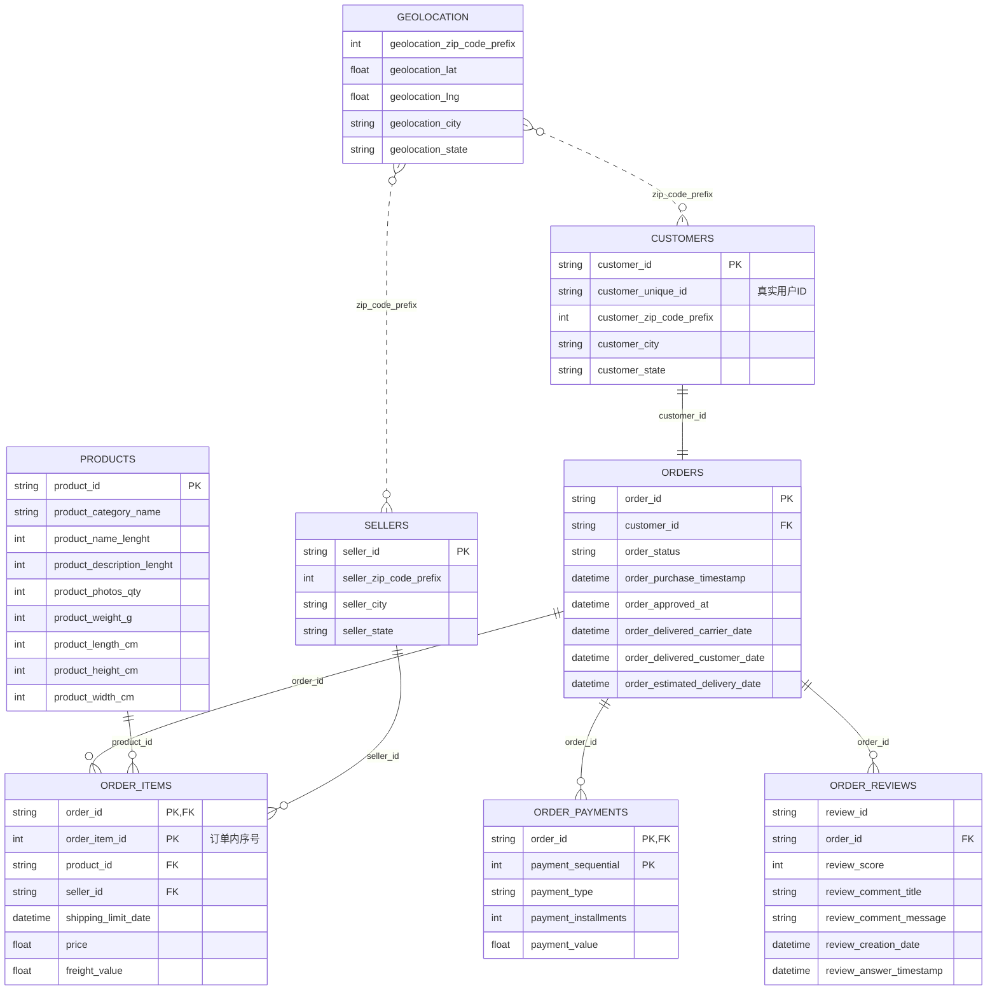

# 1，olist_customers_dataset

# 客户数据集

# 此数据集包含客户及其位置信息，

# customer_id(订单数据集的关键信息。每个订单都有一个唯一的 customer_id。), customer_unique_id(客户的唯一标识符),customer_zip_code_prefix(客户邮政编码的前五位数字),customer_city(客户所在城市名称),customer_state(客户所在州名称)

# 2，olist_geolocation_dataset

# # 地理位置数据集

# geolocation_zip_code_prefix(邮政编码的前5位数字),geolocation_lat(纬度),geolocation_lng(经度),geolocation_city(客户所在城市名称),geolocation_state(客户所在州名称)

# 3，olist_order_items_dataset

# 订单项数据集

# order_id 订单唯一标识符 order_item_id 用于标识同一订单中包含的商品数量的顺序编号 product_id 产品唯一标识符 seller_id 卖家唯一标识符 shipping_limit_date 显示卖家将订单移交给物流合作伙伴的发货截止日期 price 商品价格 freight_value 商品运费单价

# 4，olist_order_payments_dataset

# 支付数据集

# order_id 订单唯一标识符 payment_sequential 支付顺序 payment_type 支付类型 payment_installments 分期付款 payment_value 交易金额

# 5，olist_order_reviews_dataset

# 订单评论数据集

# review_id评论唯一标识符 order_id 订单唯一标识符 review_score 评分 review_comment_title 标题 review_comment_message 留言 review_creation_date 显示向客户发送满意度调查的日期 review_answer_timestamp显示满意度调查回答时间戳

# 6，olist_orders_dataset

# 订单数据集

# order_id订单唯一标识符 customer_id order_status 客户数据集的关键信息。每个订单都有一个唯一的 customer_id order_status订单状态 order_purchase_timestamp 显示购买时间 order_approved_at显示付款批准时间 order_delivered_carrier_date交给物流商的时间 order_delivered_customer_date实际订单交付日期 order_estimated_delivery_date被告知的预计交货日期

# 7，olist_products_dataset

# 产品数据集

# product_id产品标识符 product_category_name产品类别 product_name_lenght产品名称长度 product_description_lenght产品描述长度 product_photos_qty产品照片的数量 product_weight_g产品重量克 product_length_cm 产品长度厘米 product_height_cm产品高度厘米 product_width_cm产品宽度厘米

# 8，olist_sellers_dataset

# 卖家数据集

# seller_id卖家唯一标识符 seller_zip_code_prefix卖家邮政编码的前5位数字 seller_city卖家所在城市 seller_state卖方州

# 9，product_category_name_translation

# 类别名称翻译

# product_category_name葡萄牙语中的类别名称 product_category_name_english英语中的类别名称

